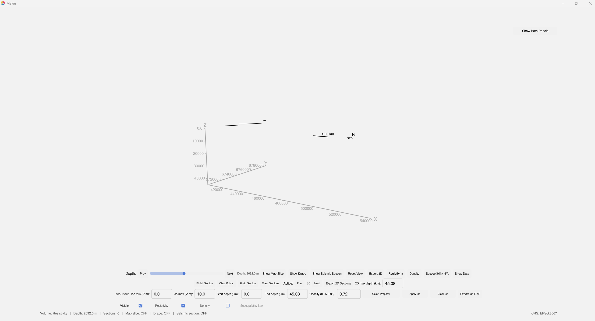
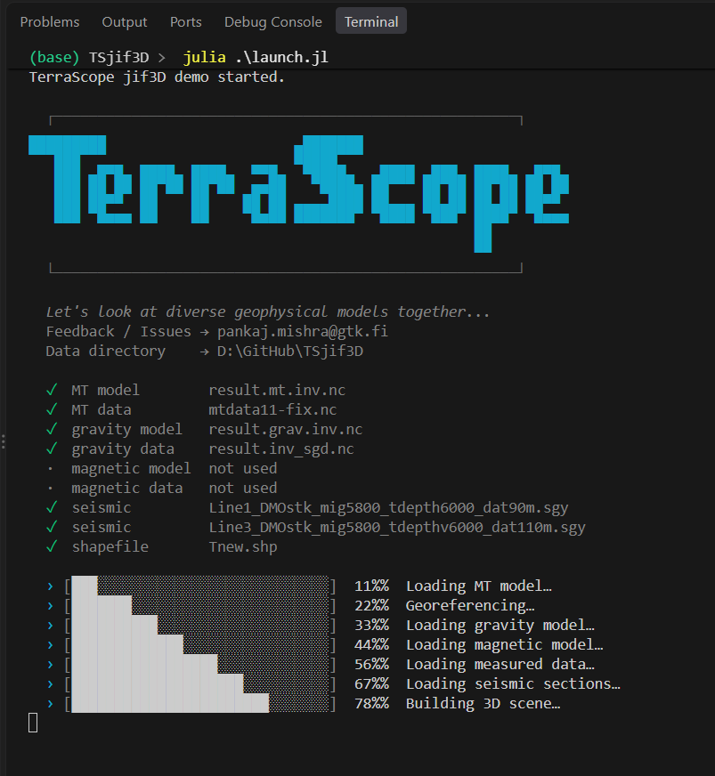

# TerraScope.jl

[](https://github.com/JuliaGeophysics/TerraScope.jl/actions/workflows/CI.yml)
[](https://juliageophysics.com/TerraScope.jl/dev/)

A 3D viewer for MT, gravity, magnetic, seismic and shapefile data.
Part of [JuliaGeophysics](https://github.com/JuliaGeophysics).



## Quick start

```shell
git clone https://github.com/JuliaGeophysics/TerraScope.jl
cd TerraScope.jl
julia --project=. -e "using Pkg; Pkg.instantiate()"
julia --project=. examples/launch_TerraScope3D.jl
```

Set your file paths in `examples/launch_TerraScope3D.jl`.
Julia 1.12 or newer is necessary. Julia 1.13.0 is recommended, because it precompiles faster.



## Documentation

[juliageophysics.com/TerraScope.jl](https://juliageophysics.com/TerraScope.jl/dev/)
